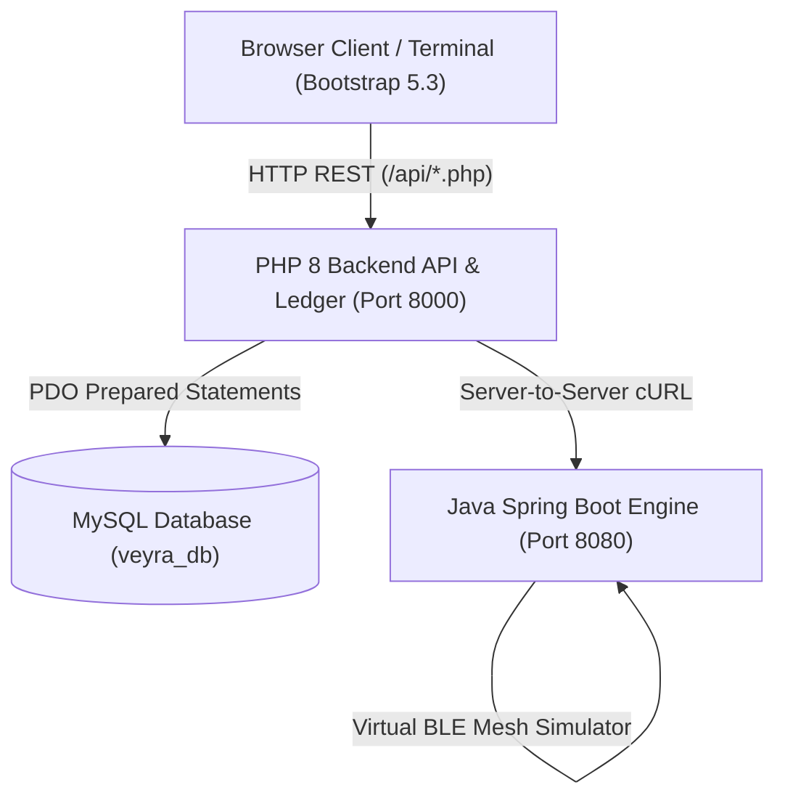

# VEYRA — Secure Transactions. Resilient Networks.
> **Offline UPI Messaging & Resilient Mesh Protocol Prototype**  
> Built with Bootstrap 5.3, Native PHP 8 Backend (PDO / MySQL), and Core Java Spring Boot Cryptographic Engine.

---

## 1. System Architecture Overview

VEYRA solves payment connectivity failure in network-compromised or remote environments using an offline store-and-forward mesh routing protocol paired with an enterprise PHP backend and Java cryptographic verification engine.



### Component Breakdown
1. **Frontend Presentation Layer (`backend-php/public/`)**:
   - Clean, minimal human-designed administrative interface inspired by high-density education/banking portals.
   - Built on **Bootstrap 5.3.3**, Vanilla JavaScript, and **Bootstrap Icons**.
   - **3 Theme Modes**: Light Mode, Dark Navy Mode, and dynamic System Mode with OS `prefers-color-scheme` listener and `localStorage` persistence.
   - Live telemetry polling (every 8s) for metrics, transactions, offline outbox queue, and mesh peers.

2. **PHP 8 Backend Engine (`backend-php/`)**:
   - Genuine server-side coordination layer utilizing native **PDO MySQL** with prepared statements (`ATTR_EMULATE_PREPARES => false`).
   - Browser-facing endpoints for transaction authorization, outbox queues, mesh coordination, and ledger reconciliation.
   - Strict server-side input validation returning semantic HTTP status codes (`422 Unprocessable Entity`, `201 Created`, `200 OK`).
   - Secure server-to-server HTTP client communicating with the Java microservice without exposing Java internal ports to the browser.

3. **Core Java Verification Service (`UPI_Without_Internet-main/`)**:
   - Preserved unmodified original algorithm implementing hybrid encryption:
     - 2048-bit RSA with OAEP (SHA-256 / MGF1 padding) for symmetric key exchange.
     - 256-bit AES-GCM for tamper-evident payment payload authentication.
   - Virtual BLE mesh simulator routing packets across multi-hop peer nodes (`phone-alice` &rarr; `phone-stranger1` &rarr; `phone-stranger2` &rarr; `phone-stranger3` &rarr; `phone-bridge`).
   - Replay protection with strict freshness windows, cryptographic hashes, and idempotency locks.

---

## 2. Prerequisites & Environment Setup

- **PHP**: PHP 8.0+ (Tested on PHP 8.0.28 / 8.2) with `pdo_mysql`, `curl`, and `json` extensions.
- **Java**: OpenJDK 17+ (or 21 / 26).
- **Database**: MySQL 5.7+ or MariaDB 10.3+ (e.g. XAMPP or native Homebrew MySQL on `127.0.0.1:3306`).
- **Web Server**: PHP Built-in Server (development) or Apache/Nginx.

---

## 3. Quick Start & Execution Guide

### Step 1: Database Initialization
1. Ensure MySQL is running on `127.0.0.1:3306`.
2. Import the database schema and demo seed records:
   ```bash
   /Applications/XAMPP/xamppfiles/bin/mysql -u root < database/schema.sql
   ```
   *This initializes the `veyra_db` schema with 8 normalized tables: `users`, `accounts`, `transactions`, `transaction_status_history`, `idempotency_records`, `offline_queue`, `mesh_nodes`, and `audit_events`.*

### Step 2: Start the Java Spring Boot Engine
In a dedicated terminal:
```bash
cd UPI_Without_Internet-main
./mvnw spring-boot:run
```
- Java service will bind to `http://127.0.0.1:8080`.
- Health check: `curl http://127.0.0.1:8080/api/accounts`

### Step 3: Start the PHP Backend Server
In another dedicated terminal:
```bash
php -S 127.0.0.1:8000 -t /Users/atulanand/Desktop/Veyra/backend-php/public
```
- The dashboard and API will be live at `http://127.0.0.1:8000`.

---

## 4. API Endpoints Reference

All frontend interactions communicate with genuine PHP backend endpoints:

| Endpoint | Method | Description |
| :--- | :---: | :--- |
| `/api/health.php` | `GET` | Health check reporting status of PHP, MySQL (`veyra_db`), and Java service |
| `/api/accounts.php` | `GET` | Fetches active demo accounts and real ledger balances |
| `/api/transactions.php` | `GET` | Retrieves paginated transactions list and aggregate status counts |
| `/api/transactions.php` | `POST` | Composes offline payment instruction, encrypts with RSA/AES, and queues to mesh |
| `/api/queue.php` | `GET` | Inspects offline outbox vault packets and TTL hops |
| `/api/mesh.php` | `GET` | Retrieves real-time virtual mesh topology and packet distributions |
| `/api/mesh.php` | `POST` | Triggers a gossip round (`action: "gossip"`) or resets mesh state (`action: "reset"`) |
| `/api/synchronize.php` | `POST` | Flushes bridge uploads to bank ledger and reconciles double-entry accounts |
| `/api/system.php` | `GET` | Exposes public key fingerprint, hybrid crypto scheme, and audit trail events |

---

## 5. Automated Verification & Test Suite

To verify the complete full-stack integration and security rules:
```bash
php tests/verify_redesign.php
```

### Test Suite Results (12/12 Passing)
- **Test 1**: Health API returns `HEALTHY` and `UP` for PHP, MySQL, and Java `[PASS]`
- **Test 2**: Accounts API returns seeded demo bank accounts with real balances `[PASS]`
- **Test 3**: Validation rejects negative amount with HTTP 422 `[PASS]`
- **Test 4**: Validation rejects non-existent sender VPA `[PASS]`
- **Test 5**: Validation rejects self-transfer `[PASS]`
- **Test 6**: Create valid offline payment via PHP & Java bridge `[PASS]`
- **Test 7**: Offline Outbox Queue holds encrypted packet `[PASS]`
- **Test 8**: Mesh API retrieves peer devices and bridge status `[PASS]`
- **Test 9**: Mesh gossip propagates packet toward bridge nodes `[PASS]`
- **Test 10**: Bridge upload flushes packets and settles ledger `[PASS]`
- **Test 11**: Transaction record is updated to `SYNCHRONIZED` in MySQL `[PASS]`
- **Test 12**: System API returns RSA public key and audit events `[PASS]`

---

## 6. Security & Integrity Guarantees

1. **True Hybrid Encryption**: Payment instructions are packaged into AES-256-GCM authenticated ciphertexts before entering peer relay hops. Intermediate stranger devices can never inspect amounts, sender/receiver identities, or tamper with packet contents without triggering MAC authentication failure.
2. **Double-Spend & Replay Defense**:
   - Each transaction envelope contains a cryptographically random UUID nonce and epoch millisecond signature timestamp.
   - Packets older than the freshness threshold are rejected.
   - Idempotency records track unique SHA-256 ciphertext hashes at the bank ingestion gateway.
3. **Optimistic Concurrency Control**: Account balances in both MySQL and Java JPA use version column locking to prevent race conditions during concurrent bridge flush storms.
