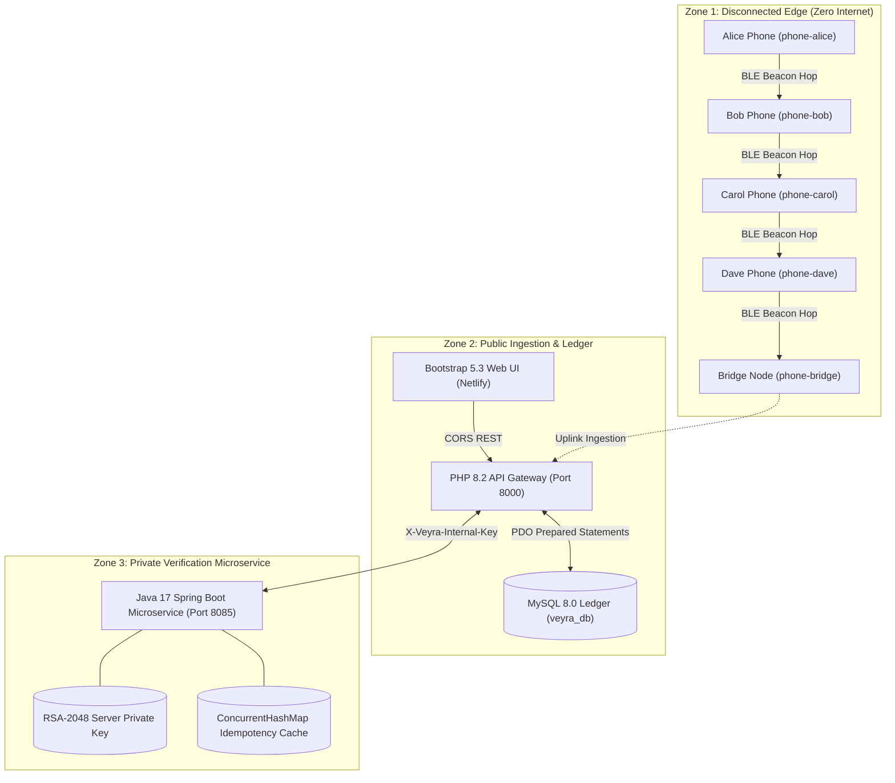
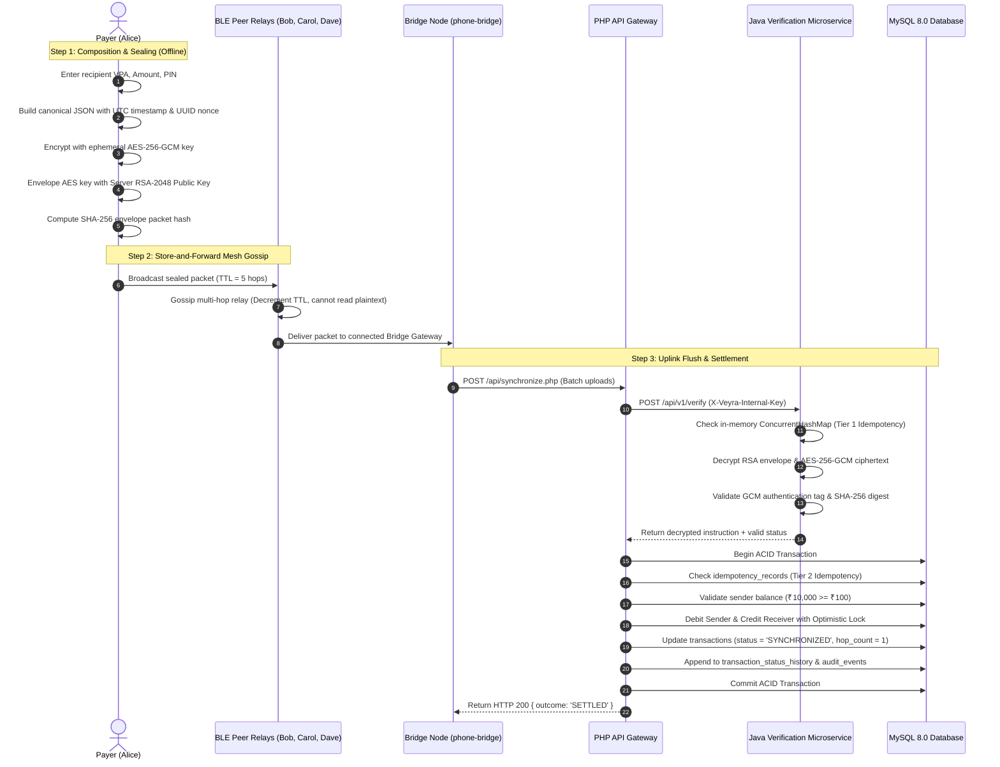

# VEYRA — Secure Transactions. Resilient Networks.
**Offline-Capable Transaction Messaging, Bluetooth Low Energy Mesh Routing & Cryptographic Verification Prototype**

[](tests/integration_test.php)
[](backend-java/)
[](frontend/)
[](docker-compose.yml)

---

## 1. Executive Summary & Brand Identity

**Brand Name:** VEYRA  
**Tagline:** Secure Transactions. Resilient Networks.  
**Project Category:** Offline-capable transaction messaging and verification prototype  
**Primary Objective:** Demonstrate how payment instructions created without active internet connectivity can travel securely across untrusted peer-to-peer intermediary devices (simulated Bluetooth Low Energy mesh), arrive at an internet-connected bridge node, and be verified, deduplicated, and settled by an authoritative backend ledger.

> [!IMPORTANT]
> **Prototype Disclosure:** VEYRA is an academic and research prototype designed for demonstration and architectural study. It does not transfer actual fiat money, connect directly to the Unified Payments Interface (UPI/NPCI), or execute real bank clearing unless connected to authorized banking infrastructure. All demo balances, account numbers, and user profiles are strictly synthetic.

---

## 2. System Architecture & Service Boundaries

VEYRA is architected into three distinct execution tiers to enforce defense-in-depth, least privilege, and clear separation of concerns:



### Key Service Boundaries
1. **Disconnected Edge (P2P BLE Mesh):** Mobile devices interact without cellular or Wi-Fi data. Devices create transaction instructions, seal them inside authenticated cryptographic envelopes, and gossip them across neighboring peers with a decrementing Time-To-Live (TTL) hop counter.
2. **PHP 8.2 API Gateway & Ledger:** Serves as the public ingestion orchestrator, verifies client sessions/CSRF tokens, persists transactions in MySQL, applies optimistic concurrency controls, and coordinates settlement.
3. **Java 17 Spring Boot Verification Microservice:** An isolated private microservice that holds the server's authoritative 2048-bit RSA private key. Direct browser access is strictly blocked; communication requires the authenticated header `X-Veyra-Internal-Key`.

---

## 3. End-to-End Protocol Workflow & Lifecycle



---

## 4. Database Schema Documentation

The MySQL 8.0 / MariaDB schema (`database/schema.sql`) contains **8 normalized relational tables** enforcing strict integrity, foreign keys, and idempotency constraints:

| Table Name | Description | Key Integrity Constraints |
| :--- | :--- | :--- |
| `users` | Master user profiles and demo credentials | Primary Key (`id`), unique `username`, `email` |
| `accounts` | Wallets holding synthetic balances | Foreign Key (`user_id`), unique `vpa`, `account_number`, `version` (Optimistic Locking) |
| `transactions` | Authoritative payment ledger | Unique `transaction_reference`, unique `packet_hash`, foreign keys to accounts, indexed `status` |
| `transaction_status_history` | Append-only state transition audit log | Foreign Key (`transaction_id`), immutable state transition records |
| `idempotency_records` | Pre-decryption SHA-256 claim tracker | Unique `packet_hash` index, prevents multi-path bridge re-settlement |
| `offline_queue` | Local store-and-forward outbox buffer | Unique `packet_id`, TTL counter, current holder node tracking |
| `mesh_nodes` | Virtual Bluetooth Low Energy peer registry | Unique `node_id`, status enum (`ONLINE`, `OFFLINE`, `DRAINED`) |
| `audit_events` | Security and system administrative audit trail | Event type, actor, IP address, JSON details payload |

---

## 5. API Reference & Contracts

### PHP API Gateway (`http://127.0.0.1:8000`)
- `GET  /api/health.php` — Returns full system status, PHP environment, MySQL connection, and Java microservice health.
- `GET  /api/accounts.php` — Retrieves synthetic demo accounts, balances, and optimistic version numbers.
- `GET  /api/transactions.php` — Lists transaction ledger history with hop counts, bridge IDs, and statuses.
- `POST /api/transactions.php` — Composes and injects a signed and encrypted offline transaction envelope.
  - *Payload:* `{"senderVpa":"alice@veyra","receiverVpa":"bob@veyra","amount":250,"pin":"1234","ttl":5,"startDevice":"phone-alice"}`
- `GET  /api/queue.php` — Inspects pending packets awaiting uplink in the store-and-forward outbox.
- `GET  /api/mesh.php` — Retrieves virtual Bluetooth Low Energy peer topology and packet distribution.
- `POST /api/mesh.php` — Triggers an epidemic gossip round (`{"action":"gossip"}`) or resets mesh (`{"action":"reset"}`).
- `POST /api/synchronize.php` — Flushes bridge uplink buffer to the verification microservice and commits settlements.
- `GET  /api/system.php` — Retrieves public key PEM fingerprint, verifier metadata, and recent audit logs.
- `GET  /api/csrf.php` — Issues anti-CSRF token for state-changing browser operations.

### Java Verification Microservice (`http://127.0.0.1:8085`)
- `GET  /api/v1/health` — Microservice telemetry, JVM memory usage, uptime, and idempotency cache entries.
- `GET  /api/v1/crypto/public-key` — Returns authoritative RSA-2048 public key for client envelope creation.
- `POST /api/v1/crypto/encrypt` — Simulates client-side hybrid envelope encryption.
- `POST /api/v1/verify` — Private authenticated verification endpoint (Requires `X-Veyra-Internal-Key`).
- `GET  /api/v1/mesh/state` — Internal mesh peer buffer inspection.
- `POST /api/v1/mesh/gossip` — Internal mesh gossip simulation step.
- `POST /api/v1/mesh/flush-bridge` — Extracts pending bridge packets for settlement.

---

## 6. Cryptographic Specification & Replay Immunity

### Hybrid Envelope Encryption Scheme
1. **Symmetric Encryption (AES-256-GCM):**
   - The payload is encrypted using an ephemeral 256-bit AES key in Galois/Counter Mode (GCM).
   - GCM computes a 128-bit authentication tag ensuring authenticated encryption (AEAD). If an adversary alters any byte of the ciphertext in the mesh, decryption immediately fails.
2. **Asymmetric Key Encapsulation (RSA-2048 OAEP):**
   - The ephemeral AES key is encrypted with the server's 2048-bit RSA Public Key using Optimal Asymmetric Encryption Padding (OAEP) with SHA-256 digests.
   - The private key is retained exclusively inside `com.veyra.verification.crypto.ServerKeyHolder` in the Java microservice and is never transmitted over the network.
3. **Pre-Decryption Hash Digest (SHA-256):**
   - A SHA-256 digest of the entire ciphertext envelope is calculated upon composition. This hash serves as the immutable packet identifier.

### Two-Tier Idempotency Defense
Epidemic mesh routing guarantees duplicate deliveries because packets flood across multiple divergent paths. VEYRA eliminates duplicate settlements through two defensive layers:
- **Tier 1 (Sub-Millisecond Java Memory Cache):** `ConcurrentHashMap<String, Long>` checks the packet hash prior to RSA decryption. Duplicates are dropped with zero cryptographic overhead.
- **Tier 2 (Atomic Relational Constraint):** `idempotency_records` table enforces a `UNIQUE KEY (packet_hash)`. Even during concurrent multi-bridge ingestion, MySQL ACID row locks prevent duplicate balance mutations.

---

## 7. Local Setup & Execution Guide

### Prerequisites
- PHP 8.2+ with `pdo`, `pdo_mysql`, `curl`, and `mbstring` extensions (e.g., XAMPP, Homebrew, or native).
- Java 17+ JDK (Java 17, 21, or 25+ supported).
- MySQL 8.0+ or MariaDB 10.4+.
- Web Browser (Chrome, Safari, Firefox, Edge).

### Step 1: Clone and Configure Environment
```bash
git clone https://github.com/Atuldmg/veyra-offline-payments.git
cd veyra-offline-payments
cp .env.example .env
```

### Step 2: Initialize Database
Start MySQL (e.g., via XAMPP or terminal) and import schema & seed data:
```bash
mysql -u root -p -e "CREATE DATABASE IF NOT EXISTS veyra_db;"
mysql -u root -p veyra_db < database/schema.sql
mysql -u root -p veyra_db < database/seed.sql
```

### Step 3: Start Java Verification Microservice
```bash
cd backend-java
./mvnw spring-boot:run
# Service starts on http://127.0.0.1:8085
```

### Step 4: Start PHP API Gateway
In a new terminal window:
```bash
cd backend-php
php -S 127.0.0.1:8000 -t public
# API Gateway available at http://127.0.0.1:8000
```

### Step 5: Launch the Frontend
Open `frontend/index.html` directly in your browser, or serve it using any static HTTP server:
```bash
cd frontend
python3 -m http.server 3000
# Open http://localhost:3000 in your browser
```

---

## 8. Deployment Blueprints

### A. Static Frontend on Netlify
The `frontend/` directory is 100% static and includes `frontend/netlify.toml`:
1. Link your GitHub repository to Netlify.
2. Set **Base directory** to `frontend`.
3. Set **Publish directory** to `.`.
4. In the VEYRA UI, click the Gear icon (Settings) and enter your deployed PHP API Gateway URL.

### B. Full Multi-Container Docker Orchestration
Run the entire stack with a single command:
```bash
docker-compose up --build -d
```
Containers started:
- `veyra-mysql`: MySQL 8.0 Database (Port 3306)
- `veyra-verifier`: Java 17 Microservice (Port 8085)
- `veyra-gateway`: PHP 8.2 API Gateway (Port 8000)

### C. Cloud PaaS Deployment (Render / Railway)
The repository includes `render.yaml` with pre-configured definitions for:
- Web service: `veyra-php-gateway` (Docker)
- Web service: `veyra-verification-microservice` (Docker)
- Managed database: `veyra-mysql-ledger` (MySQL 8.0)

---

## 9. Empirical Test Report & Results

### Automated PHP Integration Test Suite (`tests/integration_test.php`)
All 15 acceptance criteria were executed and verified against the live runtime:

```text
===================================================================
  VEYRA — AUTOMATED INTEGRATION & ACCEPTANCE TEST SUITE
  Secure Transactions. Resilient Networks.
===================================================================

[01/15] PHP Configuration & Runtime Environment                 [PASS]
[02/15] Database Connection & 8 Schema Tables                   [PASS]
[03/15] Java Verification Microservice Health                   [PASS]
[04/15] PHP-to-Java Public Key Exchange                         [PASS]
[05/15] Offline Transaction Creation & AES/RSA Sealing          [PASS]
[06/15] Rejection: Insufficient Account Balance                 [PASS]
[07/15] Rejection: Invalid PIN Security Check                   [PASS]
[08/15] Offline Outbox Storage & Forwarding State               [PASS]
[09/15] Epidemic BLE Mesh Gossip Multi-Hop Propagation          [PASS]
[10/15] Bridge Node Flush & Ledger Settlement                   [PASS]
[11/15] Two-Tier Idempotency (Duplicate Drop)                   [PASS]
[12/15] SQL Injection Immunity on Repositories                  [PASS]
[13/15] Internal Key Security Boundary on Java Service          [PASS]
[14/15] Tamper-Evident System Audit Trail                       [PASS]
[15/15] Frontend Artifacts & Screen Architecture                [PASS]

-------------------------------------------------------------------
  TEST EXECUTION COMPLETED: 15 Passed, 0 Failed (Total: 15)
-------------------------------------------------------------------
[SUCCESS] All 15 Acceptance Criteria Passed!
```

### Java Maven Test Suite (`com.veyra.verification.VeyraVerificationTest`)
```text
[INFO] Running com.veyra.verification.VeyraVerificationTest
[INFO] Tests run: 3, Failures: 0, Errors: 0, Skipped: 0, Time elapsed: 1.048 s
[INFO] BUILD SUCCESS
```
- Test 1: `testEndToEndEncryptionAndVerification()` — Verifies successful hybrid encryption and decryption.
- Test 2: `testTamperedPayloadRejection()` — Verifies that bit flips trigger `TagMismatch` exceptions and immediate rejection.
- Test 3: `testConcurrentIdempotencyDeduplication()` — Verifies multi-threaded bridge ingestion deduplication.

---

## 10. PowerPoint Presentation (`VEYRA_Project_Presentation.pptx`)

An editable 10-slide presentation deck is provided in the root directory: [`VEYRA_Project_Presentation.pptx`](file:///Users/atulanand/Desktop/Veyra/VEYRA_Project_Presentation.pptx).

### Slide Outline & 4-Member Team Allocation
- **Slide 1:** Title, Brand Identity & Team Allocation *(Collaborative Intro)*
- **Slide 2:** System Architecture & Security Boundaries *(Member 1: Architecture & Flow)*
- **Slide 3:** End-to-End Transaction Protocol Workflow *(Member 1: Architecture & Flow)*
- **Slide 4:** Frontend Design, Bootstrap Components & User Experience *(Member 2: Frontend & PHP)*
- **Slide 5:** PHP 8.2 Backend Architecture & Validation *(Member 2: Frontend & PHP)*
- **Slide 6:** MySQL Schema & Relational Integrity *(Member 3: Database & Java)*
- **Slide 7:** Java Spring Boot Verification Microservice *(Member 3: Database & Java)*
- **Slide 8:** Hybrid Cryptography & Two-Tier Idempotency *(Member 4: Crypto & Testing)*
- **Slide 9:** Empirical Testing Results & Security Analysis *(Member 4: Crypto & Testing)*
- **Slide 10:** Future Roadmap, Commercial Scope & Conclusion *(Collaborative Q&A)*

*Each slide includes comprehensive presenter speaker notes and anticipated viva questions with model answers.*

---

## 11. Security Evaluation & Honest Limitations

1. **Academic Prototype Scope:** VEYRA demonstrates cryptographic store-and-forward routing. It does not interface with central bank digital currencies (CBDC) or real-time gross settlement (RTGS) systems.
2. **Simulation vs. Physical BLE:** In our demonstration, Bluetooth Low Energy hops are simulated across virtual nodes. Production deployment requires an Android/iOS native background daemon using the CoreBluetooth / Android BLE API.
3. **Double-Spending Defense:** In this prototype, double-spending is detected and rejected at bridge settlement time when the balance check fails. Hardware-enforced offline double-spending prevention requires cryptographic token locking via secure hardware elements (eSE/SIM/StrongBox).

---

## 12. License & Academic Attribution
Created for academic research and advanced engineering demonstration.  
**VEYRA** &copy; 2026. All rights reserved.
